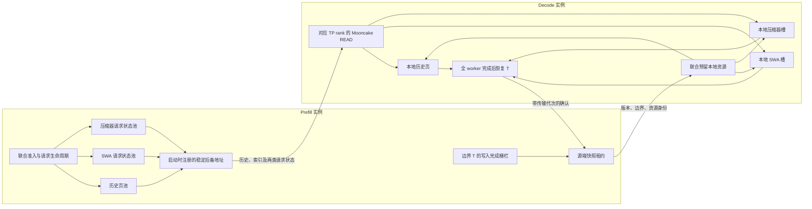
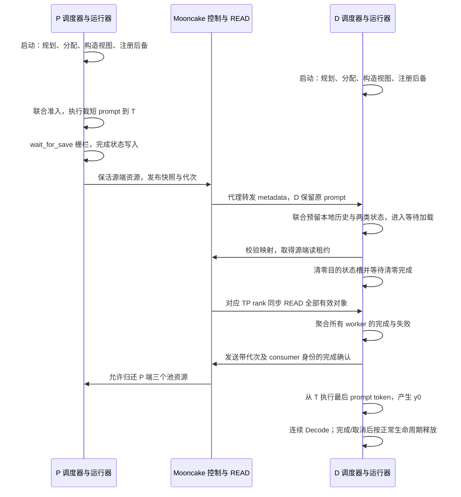

# DeepSeek V4.1 历史/请求状态分离：PD 适配设计

2026-10-30｜目标：沿用既有三个固定资源池，通过 Mooncake pull 交接完整请求状态。

## 1. 当前交付与结论边界

**主路径选择 `MooncakePullConnector`，即模块化 Mooncake V2 点对点 READ 路径。**
复用其注册、调度元数据、接收线程、同步 READ、全 worker 完成聚合和调度器确认；
本轮不改 AscendStore 外部 KV 池，也不重写 PD 框架。

|状态|本次内容|
|---|---|
|源码已确认|固定版本的分配、注册、末 token 留给 D 的协议、接收完成、取消延迟释放调用链；最新主线相关注册假设|
|本地已实现|逐池容量注册；有版本状态描述；P/D 本地 ID 映射；源端租约；有效范围 READ；D 端清零与加载顺序；联合状态准入及申请异常回滚|
|离线已验证|11 组标准 Python 测试，包含直接执行当前注册、准入、调度、接收方法；边界/映射、CPU 环恢复、失败与复用检查|
|待上卡验证|真实 NPU/DMA/图/流行为；完整模型首步和连续 Decode 的状态及数值对照；PD 生命周期压力；PD 性能|
|设计假设|相同真实权重和精度；对应 TP rank 的格式相同；同步 READ 成功返回意味着该调用的 DMA 已完成且可见。最后一项需在目标传输后端核实|

这是一份可调试实现及维护方案，尚不能称为“PD 已验证可用”。本次 c01 只重新测试常规
Prefill/Decode 混部，未启动 PD 服务；其结果不能作为本适配的硬件证据。

## 2. 代码基线、当前上游与 PR

|对象|精确版本与用途|
|---|---|
|已测 vLLM|`ced6857afa0ea7b2e3f0846a62e1394e90f15607`|
|已测 Ascend 基线|`8fde6d4e335fe300e2b949aab0e31659cce0811d`|
|已有本地 main checkout|`064bfe152a1357584c91f773b2e787cc9d18e4c3`，只读核对，未在其上覆盖实现|
|本次获取的上游 main|`0bbf9248abdab3fa4256dc955bdb57abc06229e8`，用于审计，未混入复测或 PD 开发基线|
|已测实现保存分支|`feat/dsv41-history-request-state`，提交 `f77bee84a5299c2e62d749409a29352aaf7e48b9`|
|PD 开发分支|`feat/dsv41-state-pd-mooncake`，继承上述保存分支；最终 SHA 记录在交付版本清单|
|固定镜像 ID|`sha256:ce42d65b2403992ad2e2b06c61f4f048babb57e455cfe307b018345e36c5e98b`|

两个分支位于 [immengzi/vllm-ascend](https://github.com/immengzi/vllm-ascend)。
保存分支的六个关键文件与归档逐字节一致。PD 分支将核心实现移入模型包，避免依赖
examples 目录导入运行时模块，并取消从旧实验文件/预算环境变量推导 planner 容量。
原实验数据和已测源码目录保持原样。

截至本次核对，下列 PR 均 **open、未合入**：

|PR|与本项目的关系|
|---|---|
|[#18359](https://github.com/vllm-project/vllm-ascend/pull/18359)|规划器接入上游 builder；是后续正式接入位置，不自动实现请求状态交接|
|[#19096](https://github.com/vllm-project/vllm-ascend/pull/19096)|混合注意力的独立页池及向量准入；不能直接代替 DSV4.1 固定状态协议|
|[#19249](https://github.com/vllm-project/vllm-ascend/pull/19249)|AscendStore 逐组块数注册；属于外部池，不是本次点对点 PD 适配|
|[#20266](https://github.com/vllm-project/vllm-ascend/pull/20266)|MRV2 的 SP/SWA bounded replay；不改变 KV 存储，也不证明本适配的 MRV1 PD 正确性|

PR head SHA、更新时间及源码锚点另存于版本/审计证据。没有把未合入 PR 当成运行依赖。

本次 c01 固定镜像中的分发包为 `mooncake-transfer-engine-npu==0.3.11.post1`；
这里只读取包元数据，未初始化 PD Transfer Engine。明天须记录目标环境实际版本，
并验证同步 READ 的完成可见性和失败语义。

### 2.1 重新核实的风险

|路径|源码现状及本次处理|
|---|---|
|Mooncake V1 单文件 connector|仍有 `tensor_num_blocks // self.num_blocks` 的注册公式；49 槽与 8877 历史页不能机械相除。本轮不适配 V1|
|Mooncake V2 `base_worker.py`|同样存在统一块数缩放；但它按缓存名称组织元数据，并已有配置后备存储注册接口，适合局部增加逐池容量|
|V2 原生状态支持|已有 CircularBuffer/Mamba 的特定传输与末 token 处理；它们不自动识别自定义 SWA 请求槽、独立容量和本协议的代次|
|AscendStore|主线仍检查 `tensor_num_blocks % self.num_blocks == 0`；这是独立的外部池兼容问题|
|只传 block IDs|不能证明窗口/压缩器的 token 边界与本地 ID 所属池。本次增加完整快照描述、双方本地资源表及源端租约校验|

以上为固定 commit 上的源码结论；没有把旧分析直接写成最新主线的运行故障。

## 3. 架构与传输对象

每侧仍是历史、SWA、压缩器三个固定容量池。状态槽在所属池内复用，不与历史池动态互借。
共享批级窗口 staging 是计算临时区，不属于交接快照，也不需要跨实例复制。

### 3.1 实测模型对应的物理对象

表中 H 是本侧历史容量，S 是本侧状态物理槽数；P/D 的 H、S 可以不同。0 号槽保留为空，不能传输。

|对象|数量与每个视图形状|dtype|有效内容|
|---|---|---|---|
|压缩比 2 历史 KV|3 个 `[H,64,1,512]`|BF16|前 `floor(T/2)` 个压缩行|
|相应稀疏索引 K|3 个 `[H,64,1,128]`|INT8|与对应历史行相同|
|相应索引 scale|3 个 `[H,64,1,1]`|FP16|与 K 一起传，保留页 stride 与独立偏移|
|压缩比 1 历史 KV|1 个 `[H,128,1,512]`|BF16|前 T 行|
|相应索引 K / scale|各 1 个 `[H,128,1,128]` / `[H,128,1,1]`|INT8 / FP16|前 T 行|
|SWA 窗口|40 个 `[S,128,1,512]`|BF16|每请求最近 `min(T,128)` 行，保留物理环序|
|压缩器中间状态|3 个 `[S,32,1,1024]`|FP32|KV 投影和 gate/score，最近 `min(T,32)` 行|

稀疏索引的持久 K/scale 必须交接；某一步选出的临时 top-k 索引在下一步按 query 重新产生，
不把它误当作持久历史对象。压缩器前置 FP32 投影属于快照，未移植或改变其他引擎的量化格式。

当前几何为 8 个历史 arena、40 个窗口 arena、3 个压缩器 arena，共 51 个后备；
索引 K/scale 是同一 arena 中的不同逻辑视图。每历史页合计 369280 B，
每活跃请求完整状态合计 5636096 B（5.375 MiB）/rank。注册大小和请求传输字节分别统计。

本实现记录实际 shape、dtype、行宽、页 stride、容量、所属池和 `tokens_per_row`，
只接受页内连续行；不把任意 stride 静默展平。每个逻辑视图保留自己的基址，避免丢掉索引 scale。
传输只复制有效行和末页有效范围，不复制无效历史页尾、其他请求槽或整个状态池。

### 3.2 ID 与分片

- 资源表固定为历史组、窗口组、压缩器组三项；编号只能在对应池内解释。
- 例如 P 可使用历史 `[81,82]`、窗口 7、压缩器 3；D 预留历史 `[14,25]`、窗口 5、压缩器 9。
  READ 描述分别计算源/目的偏移，既不要求两侧 ID 相同，也不要求两个状态池的 ID 相同。
- 首版每个 D TP rank 从相同 P TP rank 读取全部相关对象。即使某些 KV 副本可互换，也不将通用 MLA
  的随机副本路由应用于压缩器状态。减少冗余副本传输留待正确性证据充分后处理。
- 传输前一次性校验完整对象集合、格式、权重身份、TP、边界、ID 范围与重复/null ID。
  任一项不满足则不提交 DMA。

## 4. 一致的 token 边界

令原始 prompt 长度为 N，索引从 0 开始，首版要求 **N≥2，T=N−1**。

1. P 仅处理原 prompt 的 `[0,T)`，即最后已处理位置 T−1。
2. P 会为该截短 prompt 采样一个占位 token。代理只转发交接 metadata，这个采样不是用户的首个输出，不能追加给 D。
3. D 保留完整原 prompt，从状态 T 开始，只处理原 prompt 的最后 token `x[T]`。
4. 这一步完成后状态边界为 N，并产生真实第一个输出 `y[0]`；下一步输入 `y[0]`，绝对位置为 N。

因此不传“完整 prompt 后的状态再重复末 token”，也不依赖 P 的占位采样重建 D 输入。
N=1 暂时明确拒绝 PD，避免退化路径暗中重复更新；本地非 PD 不受该最小长度限制。

快照携带并验证：

|字段|在边界 T 的值|
|---|---|
|统一已处理边界 / D 下一输入绝对位置|T|
|原 prompt 长度|T+1|
|窗口有效长度 / 下一写位置|`min(T,128)` / `T % 128`|
|压缩器有效长度 / 下一写位置|`min(T,32)` / `T % 32`|
|已完成压缩对数 / 残余 token 数|`T // 2` / `T % 2`|
|格式与所有权|协议版本、权重身份、配置指纹、TP、P 请求身份、UUID 传输代次|

raw ring 的第 i 行保持“绝对位置 mod 环长度”的语义。加载后，调度器已有的
`num_computed_tokens=T` 进入 runner；窗口与 C2 metadata 继续从绝对位置推导，
不另维护容易与调度器漂移的进度计数器。代码也检查传入的上述派生字段一致。

## 5. 按顺序的实际调用链

缓存注册发生在启动阶段；每个请求只预留已注册地址的使用权。

|顺序|复用接口及具体接入|
|---|---|
|1. 规划、后备分配|模型 `cache_config` / `request_state.make_config`；runner 按每个 arena 的实际容量构造视图|
|2. 一次性注册|`MooncakeBaseConnectorWorker.register_kv_caches`；复用 `collect_configured_register_regions`、`global_te.register_buffer`；状态容量独立于历史页数|
|3. P 完成写入|现有 runner mixin 在 forward 后调用 `wait_for_save`；首版在 P 主流上保守同步。DSA 原路径在消费/提交前已 join 辅助流|
|4. 生成描述并保活|`MooncakePullConnectorScheduler.request_finished`；要求已完成边界且无在途 token，构造快照与源端租约，返回 delayed-free|
|5. D 预留|`get_num_new_matched_tokens` 报告 T 个外部 token；现有 `KVCacheManager.allocate_slots` 分配历史，同时先检查两个独立状态池|
|6. 将本地 ID 送给 worker|`update_state_after_alloc` → `build_connector_meta` → `ReqMeta`；包含本地完整资源表、远端资源表和状态快照|
|7. 加载|`start_load_kv` → 既有 pull 接收队列 → 状态适配方法；完成校验和读租约后清零目的槽，再调用原 `batch_transfer_sync_read`|
|8. 恢复并允许执行|既有 `KVConnectorTransferResults` 聚合所有 TP worker。全部成功后才离开等待远端 KV 的状态|
|9. 首步 D|使用本地状态 ID、已恢复的 raw ring 和 T；首次真实输出来自 D 对最后 prompt token 的执行|
|10. 确认与释放|既有 scheduler-to-scheduler 通道承载带代次确认；复用 vLLM 的 delayed-free 和各组 manager 回收|
|11. 取消/失败|接收中的 D 请求沿用 `WAITING_FOR_REMOTE_KVS` 延迟释放；失败与完成一起上报，要求 `kv_load_failure_policy=fail`|

固定 vLLM 源码已确认：取消等待加载的请求会保留资源到接收完成，随后才 `_free_blocks`；
runner 的初始化/新块清理先于异步加载；两类固定状态 manager 不记录统一历史 ID 的清零任务。
本适配对 D 状态的显式清零只放在 READ 前，完成后不重新初始化。
这些顺序仍需在新环境用事件/状态证据复核，尤其不能只看 HTTP 成功。

## 6. 预留、失败、取消与资源复用

### 6.1 多资源准入

物理容量和性能准入分别配置。新请求必须同时拿到所需历史页、一个窗口槽和一个压缩器槽。
状态池不足时返回等待，不将状态缺口伪装成“超过历史容量的页数”。
状态需求不再进入标量历史页计数，历史容量检查继续由现有分配器执行。

单线程调度器内，先检查两类状态，再进入原分配流程。申请抛异常时，仅逆序归还本次追加的资源，
恢复本请求原有 block 列表、cached 进度和新块清零列表；不释放其他请求或本请求既有资源。
已驻留请求继续复用自己的槽，不在逐步 Decode 中复制全量历史表作为事务快照。

### 6.2 源端租约与代次

只靠超时强行释放 P 地址不安全：D 可能还在 DMA。因此在现有控制通道增加读租约获取和带代次完成消息。

- P 租约绑定完整快照及其三个资源表；每个 D rank 在 READ 前验证二者，防止描述指向已复用的源槽。
- 同一代次只绑定一个 consumer；控制消息可幂等重试，数据 READ 不做并发重试。请求级重试应重新 Prefill 并取得新代次，不沿用已失效地址。
- 尚未被读取的过期租约可回收。已经取得读权限的租约不能由定时器释放；等待全 worker 完成确认。
- D 在 DMA 返回失败/部分失败后也通过原聚合路径报告失败，禁止首步 Decode 或静默重算；确认前双方保留在途资源。
- 取消发生在 D 准入前，可直接确认未消费的代次；准入后则等待既有接收完成聚合，不能先复用目的槽。
- 同一外部请求 ID 再次使用会得到新 UUID；旧确认只作用于旧代次。完成 tombstone 有界，未知旧 UUID 的 DONE 仅作无副作用确认，ACQUIRE 始终拒绝。

**故障边界：** 若已获取租约的接收进程/网络彻底失联，首版隔离其源端资源并记录错误，
不假装超时就是 DMA 完成。需先终止相关传输会话并确认 DMA 已静止，再清理/重启对应实例。
这是有界资源隔离策略，尚不是具备连接撤销和自动回收能力的完整高可用方案；禁止手工把该槽直接放回空闲队列。

### 6.3 地址和异步约束

51 个 arena 的后备地址在注册后保持稳定；请求结束仅归还池内 ID。
不进行池间互借、VMM 重映射、sleep/offload 迁移或在注册后替换 Tensor storage。
P 快照稳定后该请求不再写其资源；其他请求仍可使用其他槽。
图执行使用原持久地址和索引缓冲，D 首步按本地 ID 更新内容。

首版 P 栅栏及 D 清零栅栏偏保守，优先明确写入/READ 依赖；尚未宣称这些同步开销最优。
未来可在有 NPU 时间线证据后改为请求完成事件，不能提前省掉依赖。

## 7. 具体改动与维护位置

|代码|职责与复用关系|
|---|---|
|`models/deepseek_v41/request_state.py`、`state_kernels.py`|从已测实现迁入包内；保留窗口、图和 DSA CP 协议；显式状态准入、追加分配回滚；预算来自框架|
|`kv_p2p/dsv41_state.py`|无 torch/硬件依赖的快照、缓存视图描述、映射与 byte-range 计划、租约状态机、回滚辅助|
|`mooncake/dsv41.py`|从实际 Tensor 生成 shape/dtype/容量/指纹；构造对应 rank 的 READ 地址；仅在加载前清零目的状态|
|`mooncake/base_worker.py`|状态分离模式下按所属 arena 容量注册，逐逻辑视图保留元数据；复用原内存注册实现|
|`mooncake/base_scheduler.py`、`pull_scheduler.py`|复用末 token 截短；附加有版本快照；在原控制通道管理租约及代次确认|
|`mooncake/metadata.py`|握手添加状态格式描述；请求 metadata 添加快照和 consumer 身份|
|`mooncake/pull_worker.py`|在原队列/完成框架内增加完整状态 READ 分支；不改其他模型的一般传输路径|
|`mooncake/connector.py`|P 侧 forward 后建立稳定快照栅栏|
|`examples/dsv41_state`|固定依赖、启动示例、父提交校验和 NPU 门禁入口|

模型状态语义集中在模型及状态协议模块，网络执行仍归 Mooncake。
原型与上游协调器之间仍有集中安装的适配钩子，不能称为已完成正式 upstream 合入。
下一步按 builder/coordinator 的正式扩展接口替换这些钩子，复用同一快照与传输适配器，
避免再次在各 runner 和 connector 中复制模型语义。

## 8. 兼容性边界

|组合|首版策略|
|---|---|
|相同 DSV4.1 Flash W8A8、相同布局、相同 TP|实现目标；必须配置相同真实 `state_model_id`，并通过配置/实际视图指纹检查|
|MRV1、PP=PCP=DCP=1|当前明确支持的设计范围；PD 硬件证据待补|
|已有模型内部 `enable_dsa_cp`|保留原实现；对应 TP rank 传输完整状态，P/D 指纹必须一致；PD 下仍需专项验证|
|不同历史/状态池容量|允许；按各侧视图描述检查，状态数量不要求等于历史页数|
|多个 DP 引擎|沿用原实例/DP 路由；每个 engine 有独立租约与本地资源。新组合仍需逐项验证|
|不同 TP、PP、PCP/DCP、KVPP、MRV2|首版不支持；已知路径显式拒绝，不把 DSA 内部 CP 等同于 PCP/DCP|
|前缀缓存、MTP/推测解码|关闭；不尝试将可变请求状态作为共享前缀|
|AscendStore/外部 KV 池、V1、layerwise、offload、sleep|本次不适配；不得仅删除原 KV-transfer 断言后使用|
|抢占重算、跨精度/布局转换、多模态/LoRA|未由本轮证明；初测发现抢占或语义差异须停止收益验收|

源码依据：`attention/context_parallel/dsa_v41_cp.py` 的 `_ReplicatedCacheImpl`
使用全局缓存元数据，`AscendDSAV41CPImpl` 只切分本地 query，并经
`restore_tp_heads(..., get_tp_group())` 还原输出；这与框架 PCP/DCP 分组不同。
因此保留已有内部 CP 路径，并要求双方开关、TP 和布局指纹一致。
该源码依据只支持保留方案，不构成 PD 数值正确性的证明。

## 9. 验证与明天的调试顺序

### 9.1 已完成的离线检查

运行 `python3 tests/ut/distributed/kv_transfer/kv_p2p/test_dsv41_state_protocol.py`。
测试只需标准 Python；直接编译执行当前接入方法，硬件/传输以 mock 替代。

- 快照 JSON 往返，拒绝不同边界、格式、精度、身份和 TP。
- 8877/49 与 4096/17 两侧容量、不同本地 ID、K/scale 独立视图、末页有效范围、null/重复/缺失资源。
- 边界覆盖 1/2、31/32/33、63/64/65、127/128/129、255/256/257、8191/8192/8193、100k、128k 附近。
- CPU 环恢复后逐步推进 65 个 token，对照绝对窗口和压缩对的投影/score 池化 oracle。
- 实际注册/接收方法发出非零字节 READ；部分失败不报成功，旧描述无法在槽复用后再次发起 READ。
- 两个状态池分别耗尽、申请中途异常、P 末 token 截短、D 首步边界、准入前取消、超时隔离和同请求 ID 新代次。

另有 `test_dsv41_state_wire.py`：使用与原镜像相同的 `msgspec==0.22.0`，
对当前 metadata dataclass、嵌套 PP/PCP/TP 握手、HTTP 快照与控制消息进行 3 项真实 MessagePack 编解码检查。
替代 vLLM marker 基类，BlockIds 类型照固定 vLLM 定义，不替代 codec；这 3 项也已本地通过。
握手使用 typed decoder；请求资源表使用通用编解码检查，不将其写成完整 vLLM IPC 验证。

CPU oracle 使用简化投影检查交接语义，不是完整模型 BF16/NPU 数值证明。
本地尚未安装可运行完整 vLLM UT 的 torch/NPU 环境，因此不把这些测试写成完整 UT 或端到端通过。

### 9.2 待上卡门禁，按风险收敛

1. **环境与注册：** 固定代码/镜像/真实权重身份；每侧实际可装载拓扑、51 arena 和所有 rank 注册完成；对照容量与地址。
2. **相同新分支的非 PD 对照：** 先确认迁入包和显式准入没有改变本地输出/状态，再测 PD；不能只拿旧分支输出当作唯一对照。
3. **边界、首步与连续 Decode：** 先选 2、32/33、128/129、256/257 和一个长输入；固定 seed/贪心，检查逐 token 输出、SWA、C2 FP32 状态、历史 KV 与索引 K/scale。
4. **传输确实发生：** 每个 rank 记录代次、T、源/目的 ID、READ 范围与字节、开始/完成；与 D 侧仅处理末 prompt token 的调度时间线对应。故意制造传输失败应失败返回，不能变成 prompt 重算。
5. **图与流：** 比较图开/关、异步开/关的最小对照；检查 P 栅栏→READ、D 清零→READ→首次图重放，以及新 ID/不同图尺寸。
6. **生命周期压力：** 已获租约后取消、传输部分失败、控制 ACK 丢失/重复/延迟、超时、状态池单独耗尽、长短请求交替复用；收尾核对三个池全部归还或存在明确隔离记录。

优先沿用已知每实例 TP4/DP3/EP12，两侧合计 24 卡；不假设较小拓扑能装载权重。
资源、网络和时长需在新环境另行落实，本次 c01 授权不覆盖 PD 部署。

### 9.3 正确性通过后再测性能

分别报告 P、D 和整体链路：静态后备/整卡 HBM、每请求传输字节与耗时、TTFT、TPOT、
输出吞吐、有效并发及满足 SLO 的 goodput。记录主流同步和额外状态传输成本。
每个正式重复至少 100 个请求，高并发优先 `max(100,5×并发)`，预热单列并覆盖稳定运行区间。
先做一组可解释的配对，再按结果扩展，不提前铺开大矩阵。

## 10. 源码与证据入口

- 保存分支：`feat/dsv41-history-request-state`；适配分支：`feat/dsv41-state-pd-mooncake`。
- 原始依据：用户指定的技术汇报、具体改动点、兼容性分析第六节、证据与复现索引、已测安装源码及复现 manifest。
- 本次版本与 PR：`PD源码版本与PR状态-20261030.json`。
- 上游公式/路径锚点与实际运行版本 scheduler/mixin SHA：`PD证据/源码核对.json`。
- 当前源码校验、离线测试日志、补丁及分支最终 SHA：随交付版本清单和调试包保存。
- c01 新混部复测数据单独归档；不覆盖旧实验，不作为 PD 正确性证据。

复现时同时记录代码 SHA、镜像、权重身份、TP/DP/EP/CP、预算、客户端和负载；
容量改善、状态分离、物理内存互借是不同概念，不能互相替代。
